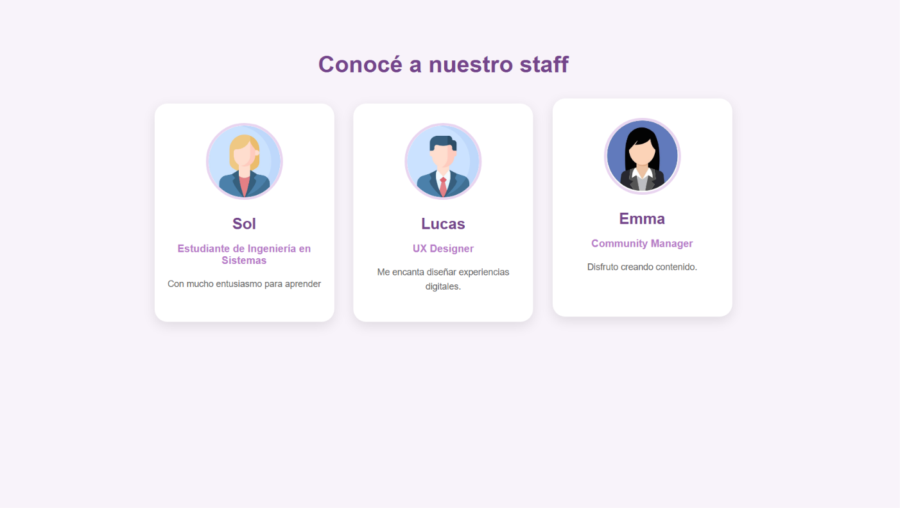

## Descripción del proyecto

Este proyecto fue desarrollado como parte del Módulo 1,
Unidad 4, del curso de Desarrollo Full Stack de UTN BA.

Consiste en una página web que presenta tres tarjetas
de integrantes de un equipo, mostrando su nombre,
profesión, imagen y una breve descripción.

El objetivo principal es practicar la creación de
componentes funcionales en React, el uso de JSX
y la utilización de props para reutilizar componentes.

## Tecnologías utilizadas

- React
- JavaScript
- JSX
- CSS3
- Vite
- HTML5

## Características

- Componente reutilizable Tarjeta.jsx.
- Uso de props para personalizar el contenido.
- Tres tarjetas con información diferente.
- Diseño con colores lilas y tonos pastel.
- Imágenes circulares.
- Bordes redondeados y sombras suaves.
- Efectos hover.
- Diseño responsive para computadoras y celulares.

## Instalación y ejecución

### 1. Clonar el repositorio

```bash
git clone https://github.com/solferrer/Tarea-2-Tarjetas-react.git
```

### 2. Entrar a la carpeta del proyecto

```bash
cd tarjetas-react
```

### 3. Instalar las dependencias

```bash
npm install
```

### 4. Ejecutar el proyecto

```bash
npm run dev
```

Abrir en el navegador la dirección local
que indique Vite.

## Capturas de pantalla

### Vista de escritorio



### Vista de celular


## Autor

**Sol Ferrer**

- Curso: Desarrollo Full Stack
- Institución: UTN BA - Centro de e-Learning
- Módulo: 1
- Unidad: 4
- Trabajo práctico: Mi tarjeta de presentación en React

## Fuentes y referencias

- React: https://react.dev/
- Vite: https://vite.dev/
- MDN Web Docs: https://developer.mozilla.org/
- Imágenes: avatares utilizados con fines educativos.
  Agregar aquí la fuente original de las imágenes.

## Conclusión

Este proyecto permitió aplicar los conceptos iniciales
de React mediante la creación de componentes funcionales,
el uso de props y la implementación de estilos CSS.

También permitió practicar la organización de archivos
y la adaptación de una interfaz a diferentes pantallas.
